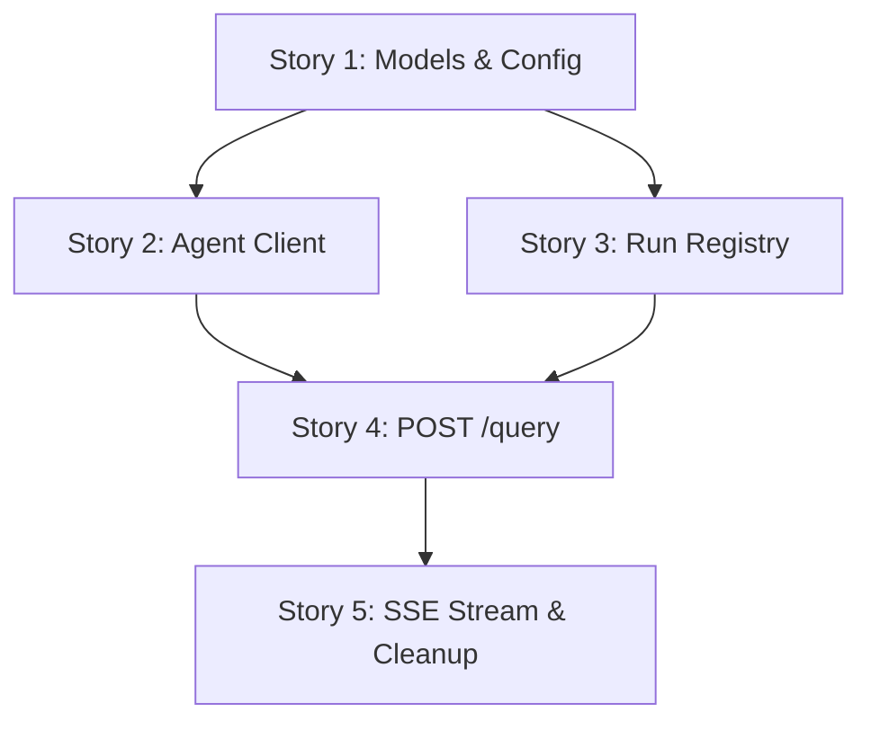

# breakdown.md

## Overview

This breakdown decomposes the FastAPI SSE integration epic into implementable stories. Each story is a session-sized implementation slice sequenced to reach the epic's Done state. Stories are ordered to deliver foundational infrastructure first, then core endpoints, then edge cases and robustness.

**Epic:** FastAPI integration with the agent  
**Repo:** See LLD (repo path not mapped; stack deferred to implementation)  
**Total Stories:** 5

---

## Dependencies & Ordering

**Build order:** 1 → 2 → 3 → 4 → 5

---

## Story Breakdown

### Story 1: Models & Config

**Repo:** See LLD

**Description:**
Define models for query requests/responses and SSE event structures. Add agent service configuration (base URL, timeouts) to config module. This provides the data contracts and configuration needed by all other stories.

**Covers Requirements:**
- AC1 (immediate response schema)
- AC2 (SSE event schema)

**Allowed Paths:**
See LLD (deferred to implementation based on repo context)

**Prerequisites:**
- None (foundational story)

**Verification Approach:**
1. Unit test: Validate request model accepts `{"query": "test"}`, rejects missing `query`
2. Unit test: Validate response model serializes `{"status": "ok", "run_id": "<uuid>"}`
3. Unit test: Validate event structures for in_progress, completed, failed
4. Unit test: Verify config loads agent service URL and timeout from environment/defaults

**Tests:** 4

**Acceptance Criteria (from epic requirements):**
- AC1: POST response returns agent's immediate reply (schema defined)
- AC2: SSE stream forwards status events (event schema defined)

---

### Story 2: Agent Client

**Repo:** See LLD

**Description:**
Implement agent client to interface with external agent service. Provides immediate query submission returning Ok/rejected reply, and asynchronous SSE event stream subscription. No polling, single subscription per run. No MCP tool calls.

**Covers Requirements:**
- AC1 (agent immediate reply)
- AC4 (no polling: single subscription)
- AC5 (no MCP tool calls)

**Allowed Paths:**
See LLD (deferred to implementation based on repo context)

**Prerequisites:**
- Story 1 (needs config for base URL/timeout)

**Verification Approach:**
1. Unit test: Mock agent POST /agent/query, verify query submission returns `{"status": "ok", "agent_run_id": "..."}`
2. Unit test: Mock agent POST /agent/query rejection, verify returns `{"status": "rejected", ...}`
3. Unit test: Mock agent timeout on query submission, verify raises timeout error
4. Unit test: Mock agent SSE stream, verify subscription yields agent events in sequence
5. Unit test: Mock agent SSE stream failure, verify subscription yields `failed` event
6. Unit test: Verify subscription creates exactly one connection per call (no polling)

**Tests:** 6

**Acceptance Criteria (from epic requirements):**
- AC1: FastAPI returns agent's immediate reply without delay (client provides reply)
- AC4: FastAPI does not poll agent (client subscribes once)
- AC5: FastAPI does not call MCP tools (code review: no MCP imports)

---

### Story 3: Run Registry

**Repo:** See LLD

**Description:**
Implement run registry to map client `run_id` to agent `agent_run_id` for SSE routing. Maintains in-memory mapping, provides lookup for SSE endpoint, and cleans up mapping after terminal event received. Does not track timestamps or status (agent owns all timing logic).

**Covers Requirements:**
- AC3 (no status creation: registry only holds ID mappings)

**Allowed Paths:**
See LLD (deferred to implementation based on repo context)

**Prerequisites:**
- Story 1 (for UUID generation pattern, though Story 3 doesn't directly depend on models)

**Verification Approach:**
1. Unit test: Verify run registration creates mapping entry with UUID `run_id`
2. Unit test: Verify agent run ID retrieval returns correct agent ID
3. Unit test: Verify run removal deletes mapping
4. Unit test: Verify agent run ID retrieval raises error for missing run_id
5. Unit test: Verify registry does not store timestamps or status

**Tests:** 5

**Acceptance Criteria (from epic requirements):**
- AC3: FastAPI does not create, decide, or delay run status (registry only maps IDs)

---

### Story 4: POST /query

**Repo:** See LLD

**Description:**
Implement POST /query endpoint. Generates run_id, calls agent client to submit query, registers run in registry, and returns immediate synchronous response. No delay, no waiting for agent completion.

**Covers Requirements:**
- AC1 (immediate POST response)

**Allowed Paths:**
See LLD (deferred to implementation based on repo context)

**Prerequisites:**
- Story 2 (needs agent client)
- Story 3 (needs registry)

**Verification Approach:**
1. Unit test: Mock agent client returning "ok", verify POST /query returns `{"status": "ok", "run_id": "<uuid>"}` in < 100ms
2. Unit test: Mock agent client returning "rejected", verify POST /query returns `{"status": "rejected", "run_id": "<uuid>"}` with 200 status
3. Unit test: Mock agent client raising timeout error, verify POST /query returns 503 with `{"detail": "Agent service unavailable"}`
4. Unit test: Verify registry registration called with generated run_id

**Tests:** 4

**Acceptance Criteria (from epic requirements):**
- AC1: When POST /query received, FastAPI returns agent's immediate reply (Ok or rejected) without delay

---

### Story 5: SSE Stream & Cleanup

**Repo:** See LLD

**Description:**
Implement GET /query/{run_id}/stream endpoint. Subscribes to agent event stream and forwards events (in_progress, completed, failed) to client in real-time. Closes stream after terminal event. Adds run_id validation (404 for missing run), agent subscription timeout (5 minutes), client disconnection detection, and registry cleanup after terminal events.

**Covers Requirements:**
- AC2 (SSE stream forwarding)
- AC3 (no status creation: only forwards agent events)
- AC4 (no polling: single subscription)

**Allowed Paths:**
See LLD (deferred to implementation based on repo context)

**Prerequisites:**
- Story 4 (POST /query creates runs)

**Verification Approach:**
1. Integration test: Submit POST /query, connect SSE stream, verify events forwarded from agent (in_progress → completed)
2. Integration test: Mock agent failure, verify SSE `failed` event received immediately, `completed` never sent
3. Integration test: Verify SSE stream closes after `completed` event
4. Integration test: Verify SSE stream closes after `failed` event
5. Unit test: GET /query/{invalid_run_id}/stream returns 404
6. Integration test: Mock agent stream timeout (no event for 5 minutes), verify SSE sends `failed` with "timeout" error
7. Integration test: Disconnect SSE client mid-stream, verify registry cleanup called
8. Integration test: Submit 100 queries, verify registry size decreases after terminal events

**Tests:** 8

**Acceptance Criteria (from epic requirements):**
- AC2: When SSE stream is opened, the stream forwards status and response events the agent already sent
- AC3: FastAPI does not create, decide, or delay run status (no timer logic, no event generation)
- AC4: FastAPI does not poll agent for status or responses (single subscription)

---

## Summary

| Story | Title | Tests | Prerequisites |
|-------|-------|-------|---------------|
| 1 | Models & Config | 4 | None |
| 2 | Agent Client | 6 | Story 1 |
| 3 | Run Registry | 5 | Story 1 |
| 4 | POST /query | 4 | Stories 2, 3 |
| 5 | SSE Stream & Cleanup | 8 | Story 4 |

**Total Tests:** 27

---

## Acceptance Criteria Coverage

| AC | Stories Covering |
|----|------------------|
| AC1: Immediate POST response | 1, 2, 4 |
| AC2: SSE stream forwarding | 1, 5 |
| AC3: No status creation | 3, 5 |
| AC4: No polling behavior | 2, 5 |
| AC5: No MCP tool calls | 2 (code review) |

---

## Open Questions

1. **Agent service contract:** Exact protocol (HTTP SSE assumed), endpoints, authentication mechanism not yet confirmed. Stories 2-5 assume HTTP/SSE; adjust if agent uses WebSocket/gRPC.
2. **Authentication:** How are queries authenticated? Is `run_id` user-scoped? Affects Story 4 (POST validation) and Story 5 (SSE access control).
3. **Agent response schema:** Shape of `response` in `completed` event unknown. Story 1 defines placeholder; adjust when schema known.
4. **Repo stack:** Repo path not mapped per repo-tree/fastapi. Stack (language, framework, file structure) deferred to LLD based on actual repo context.

---

## Notes

- **Change from original breakdown:** Removed `RunStateManager` (Stories 3 and 5-second delay logic) per `change_requests.md`. Agent now owns all timing logic. FastAPI only forwards events.
- **Simplified Story 3:** Registry now only maps IDs (no timestamps, no status tracking). Agent decides when to send events.
- **Simplified Story 5:** SSE endpoint is pure pass-through. No timer logic, no `in_progress`/`completed`/`failed` generation. Agent sends events, FastAPI forwards them.
- **Registry cleanup:** Added to Story 5 (was Story 6). Cleanup happens immediately after terminal event; no periodic task needed (no stale state to leak).
- **Story count reduced:** 6 stories → 5 stories (RunStateManager removed, Story 6 merged into Story 5).
- **Paths deferred:** Concrete file paths removed per ADLC rule (repo-tree/fastapi states "repo path not mapped; do not invent a stack"). Each story LLD will map paths based on actual repo context.

---

**Document Status:** Draft  
**Epic:** #1 (FastAPI SSE integration with agent service)  
**Altitude:** Epic breakdown (stories ready for LLD refinement)
