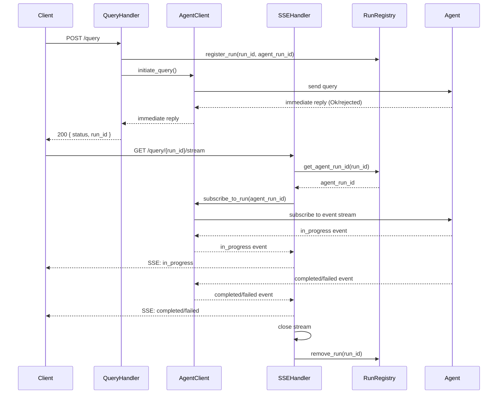

# HLD: FastAPI SSE Integration with Agent Service

## Overview

The backend provides a pure pass-through integration with an external agent service. The system accepts query requests, returns the agent's immediate synchronous reply (Ok or rejected), and forwards the agent's status events via Server-Sent Events (SSE). The backend does not create, decide, or delay run status — all timing and status logic remains on the agent side.

## Components

### 1. Query Handler (POST /query)
**Responsibility:** Accept query requests, forward to agent service, return agent's immediate reply.

**Interface:**
```
POST /query
Request body: { "query": string, ... }
Response: { "status": "ok" | "rejected", "run_id": string }
HTTP 200 (ok or rejected) or 503 (agent unavailable)
```

**Behavior:**
- Validates incoming request
- Generates unique `run_id` for client tracking
- Forwards query to agent service (non-blocking)
- Returns agent's immediate reply without delay
- Does NOT wait for agent completion
- Does NOT poll agent service

### 2. SSE Stream Handler (GET /query/{run_id}/stream)
**Responsibility:** Forward agent execution status events to clients via SSE.

**Interface:**
```
GET /query/{run_id}/stream
Response: text/event-stream
Events (forwarded from agent):
  - in_progress: { "run_id": string }
  - completed: { "run_id": string, "response": object }
  - failed: { "run_id": string, "error": string }
```

**Behavior:**
- Opens SSE connection for given `run_id`
- Subscribes to agent's event stream for that run
- Forwards events from agent to client as received
- Does NOT create `in_progress`, `completed`, or `failed` events
- Does NOT implement timer logic or delay events
- Closes stream when agent sends terminal event (`completed` or `failed`)

### 3. Agent Client
**Responsibility:** Interface to external agent service.

**Interface:**
```
initiate_query(query_data) -> immediate_reply
subscribe_to_run(agent_run_id) -> async_event_stream
```

**Behavior:**
- Sends query to agent, receives immediate Ok/rejected reply
- Subscribes to agent's event stream for status updates
- Forwards agent events to SSE handler without modification
- Does NOT poll agent
- Does NOT call MCP tools

### 4. Run Registry
**Responsibility:** Map client `run_id` to agent `agent_run_id` for SSE routing.

**Interface:**
```
register_run(run_id, agent_run_id) -> void
get_agent_run_id(run_id) -> agent_run_id
remove_run(run_id) -> void
```

**Behavior:**
- Maintains in-memory mapping of `run_id` → `agent_run_id`
- Provides lookup for SSE endpoint to find agent run
- Cleans up mapping after terminal event received
- Does NOT track timestamps or status

## Data Contracts

### Request Schema
```
QueryRequest:
  query: string (required)
  [additional fields as needed]
```

### Response Schema
```
ImmediateResponse:
  status: "ok" | "rejected"
  run_id: string (UUID)

SSEEvent (forwarded from agent):
  event: "in_progress" | "completed" | "failed"
  data: JSON object
    For in_progress: { "run_id": string }
    For completed: { "run_id": string, "response": <agent_response> }
    For failed: { "run_id": string, "error": string }
```

### Agent Response Format
```
AgentResponse:
  [shape determined by agent service contract]
```

## Component Interactions



## Architecture Decisions

### AD-1: Immediate synchronous response before agent completion
**Binds:** POST /query returns agent's immediate reply (Ok/rejected) synchronously  
**Prevents:** Client blocking on long-running agent execution  
**Rule:** Query handler must return before agent completes its work  
**Status:** [ADOPTED] - requirement AC1

### AD-2: SSE for status streaming, not polling
**Binds:** Status updates delivered via Server-Sent Events  
**Prevents:** Inefficient polling patterns, excessive load on agent service  
**Rule:** Backend opens one SSE connection per run, agent service pushes events  
**Status:** [ADOPTED] - requirement AC2

### AD-3: Backend as pure event forwarder
**Binds:** Backend does not create, decide, or delay status events  
**Prevents:** Drift between agent and backend state, duplicated timing logic  
**Rule:** All `in_progress`, `completed`, `failed` events originate from agent; backend only forwards  
**Status:** [ADOPTED] - requirement AC3

### AD-4: Single terminal event per stream
**Binds:** Stream ends with exactly one terminal event: completed XOR failed  
**Prevents:** Ambiguous stream lifecycle, missed terminal states  
**Rule:** After forwarding `completed` or `failed`, stream closes; never send both  
**Status:** [ADOPTED] - requirements from change_requests.md

### AD-5: No MCP tool calls from backend
**Binds:** Backend does not invoke MCP tools  
**Prevents:** Scope creep, coupling to agent implementation details  
**Rule:** Agent service owns all MCP interactions; backend is a pass-through  
**Status:** [ADOPTED] - requirement AC5

### AD-6: Lightweight run registry, not state manager
**Binds:** Backend only maps `run_id` to `agent_run_id`, no timing or status  
**Prevents:** Duplicated state, synchronization issues with agent  
**Rule:** Registry holds only ID mappings, not timestamps or lifecycle data  
**Status:** [ADOPTED] - requirement AC3

## Risks & Mitigations

### Risk 1: Run ID collision
**Impact:** Stream routing failure, mixed responses  
**Likelihood:** Low  
**Mitigation:** Use UUID4 for `run_id` generation

### Risk 2: Agent service unavailable during query submission
**Impact:** POST /query fails or times out  
**Likelihood:** Medium  
**Mitigation:** 
- Implement timeout on agent client calls (e.g., 3s for immediate reply)
- Return 503 Service Unavailable if agent unreachable
- Consider circuit breaker pattern for repeated failures

### Risk 3: Agent event stream disconnection
**Impact:** SSE stream stalls, client never receives terminal event  
**Likelihood:** Medium  
**Mitigation:**
- Implement timeout for agent response (e.g., 5 minutes)
- Send `failed` event and close stream on timeout
- Log disconnections for monitoring

### Risk 4: Memory leak from uncleaned run registry
**Impact:** Registry grows unbounded  
**Likelihood:** Low (simplified registry design)  
**Mitigation:**
- Clean up registry entry immediately after terminal SSE event sent in finally block
- Registry stores only ID mappings (no timestamps), so no stale state accumulates
- Monitor registry size for anomalies

### Risk 5: Client SSE connection handling
**Impact:** Client disconnects, server continues processing  
**Likelihood:** Medium  
**Mitigation:**
- Detect client disconnection (SSE connection closed)
- Cancel agent subscription on disconnection
- Clean up registry entry
- Do NOT cancel agent run itself (it may complete independently)

## Open Questions

1. **Agent service contract:** What is the exact protocol for agent's immediate reply and event stream? (HTTP? WebSocket? gRPC?)
2. **Authentication/authorization:** How are queries authenticated? Is `run_id` scoped per user?
3. **Run persistence:** Should completed/failed runs be logged to database, or is in-memory sufficient?
4. **Error details in `failed` event:** What granularity of error information should be exposed to clients?
5. **Concurrent query limit:** Should backend limit concurrent agent runs per client?
6. **Agent response size:** Are there payload size constraints for SSE events?

## Deferred

- Agent service implementation details (owned by agent team, including all timing logic such as the 5-second delay mentioned in the original ticket)
- MCP tool infrastructure (requirement AC5: backend does not call MCP tools)
- Observability/metrics (add when requirements specify logging/monitoring needs)
- Rate limiting / throttling (add when scaling requirements known)
- WebSocket alternative to SSE (SSE sufficient for one-way server→client)
- Retry logic for transient agent failures (current design: fail fast, client retries POST)
- Stack and file paths (deferred to breakdown/stories after repo context is mapped)

## Verification

### AC1: Immediate POST response
**Given** a POST request to `/query`  
**When** the request is received  
**Then** the backend returns the agent's immediate reply (Ok or rejected) without delay  
**Verification:**
- Test: Submit POST /query, measure response time independent of agent completion (Story 4, Test 1)
- Assert: Response received in < 100ms (excluding network)
- Assert: Response contains `status` and `run_id`

### AC2: SSE stream forwarding
**Given** a query has been submitted  
**When** the SSE stream is opened for that run  
**Then** the stream forwards the status and response events the agent already sent  
**Verification:**
- Test: Connect to `/query/{run_id}/stream` after POST (Story 5, Test 1)
- Assert: Events received match agent's event stream
- Assert: No events created by backend

### AC3: No status creation
**Given** the integration is running  
**When** processing requests  
**Then** the backend does not create, decide, or delay run status (no timer logic, no in_progress/completed/failed generation)  
**Verification:**
- Test: Monitor backend code and logs during request processing (Story 3, Test 5; Story 5, Tests 1-2)
- Assert: Zero timer logic or status generation code
- Assert: All events have corresponding agent event in logs

### AC4: No polling behavior
**Given** the integration is running  
**When** waiting for agent responses  
**Then** the backend does not poll the agent for status or responses  
**Verification:**
- Test: Monitor network traffic during agent execution (Story 2, Test 6)
- Assert: Zero periodic requests to agent service after initial query
- Assert: Only one subscription/connection to agent per run

### AC5: No MCP tool calls
**Given** the integration is running  
**When** processing requests  
**Then** the backend does not call MCP tools  
**Verification:**
- Test: Monitor outbound calls during request processing (Story 2, code review)
- Assert: Zero calls to MCP tool endpoints
- Assert: Agent client only calls agent service

---

**Document Status:** Draft  
**Covers Tickets:** #1 (backend SSE integration with agent service)  
**Covers Requirements:** AC1 (immediate POST response), AC2 (SSE stream forwarding), AC3 (no status creation), AC4 (no polling behavior), AC5 (no MCP tool calls)  
**Altitude:** Feature-level (single epic scope)
