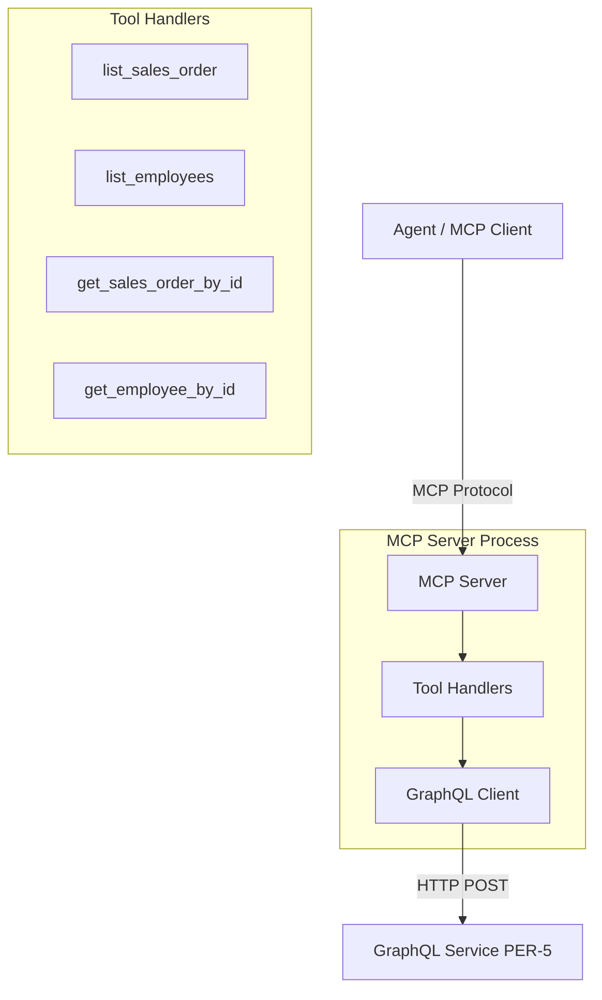

# High-Level Design: MCP Server for GraphQL Data Fetching

**Epic:** [mcp] MCP server: tools that fetch data from the GraphQL service  
**Initiative:** Demo project  
**Date:** 2025-01-20

---

## Overview

This epic implements an MCP (Model Context Protocol) server that exposes four tools for querying a remote GraphQL service over HTTP. The server acts as a protocol adapter, translating MCP tool invocations into GraphQL queries and returning standardized JSON responses. All data originates from the GraphQL service; no local schemas or mock data are managed by this server.

The implementation follows a layered architecture: GraphQL client abstraction → tool handlers → MCP server registration. The epic is delivered as one story with six incremental build steps.

---

## Architecture

### Component Diagram



### Data Flow

1. **Agent invokes tool** → MCP server receives tool call with parameters
2. **MCP server validates input** → checks required parameters (e.g., `id` for get-by-id tools)
3. **Tool handler constructs GraphQL query** → builds query string and variables
4. **GraphQL client sends HTTP POST** → queries remote GraphQL service
5. **GraphQL client parses response** → extracts data and errors from JSON
6. **Tool handler formats output** → standardizes JSON shape (`{<key>: <value>}` or `{error: <msg>}`)
7. **MCP server returns result** → sends formatted JSON back to agent

---

## Tool Specifications

### 1. list_sales_order

**Purpose:** Retrieve all sales orders from the GraphQL service.

**Input:** None

**Output:**
- Success: `{"salesOrders": [{"id": "SO-001", "customerId": "C-123", "total": 1500.0, "status": "shipped"}, ...]}`
- Empty: `{"salesOrders": []}`
- Error: `{"error": "Failed to fetch sales orders: <reason>"}`

**GraphQL Query:**
```graphql
query {
  salesOrders {
    id
    customerId
    total
    status
  }
}
```

---

### 2. list_employees

**Purpose:** Retrieve all employees from the GraphQL service.

**Input:** None

**Output:**
- Success: `{"employees": [{"id": "E-001", "name": "Alice Smith", "department": "Engineering", "email": "alice@example.com"}, ...]}`
- Empty: `{"employees": []}`
- Error: `{"error": "Failed to fetch employees: <reason>"}`

**GraphQL Query:**
```graphql
query {
  employees {
    id
    name
    department
    email
  }
}
```

---

### 3. get_sales_order_by_id

**Purpose:** Retrieve a specific sales order by ID.

**Input:** `{"id": "<sales_order_id>"}` (required)

**Output:**
- Found: `{"salesOrder": {"id": "SO-001", "customerId": "C-123", "total": 1500.0, "status": "shipped"}}`
- Not found: `{"salesOrder": null}`
- Missing ID: `{"error": "Missing required parameter: id"}`
- Error: `{"error": "Failed to fetch sales order <id>: <reason>"}`

**GraphQL Query:**
```graphql
query GetSalesOrder($id: ID!) {
  salesOrder(id: $id) {
    id
    customerId
    total
    status
  }
}
```

---

### 4. get_employee_by_id

**Purpose:** Retrieve a specific employee by ID.

**Input:** `{"id": "<employee_id>"}` (required)

**Output:**
- Found: `{"employee": {"id": "E-001", "name": "Alice Smith", "department": "Engineering", "email": "alice@example.com"}}`
- Not found: `{"employee": null}`
- Missing ID: `{"error": "Missing required parameter: id"}`
- Error: `{"error": "Failed to fetch employee <id>: <reason>"}`

**GraphQL Query:**
```graphql
query GetEmployee($id: ID!) {
  employee(id: $id) {
    id
    name
    department
    email
  }
}
```

---

## Error Handling

All tools follow a consistent error handling strategy:

1. **Input validation errors** → `{"error": "Missing required parameter: <param>"}`
2. **Network errors** (connection refused, timeout) → `{"error": "GraphQL service unavailable: <message>"}`
3. **HTTP errors** (4xx, 5xx status codes) → `{"error": "Failed to fetch <resource>: HTTP error <status>"}`
4. **GraphQL errors** (from `errors` field in response) → `{"error": "Failed to fetch <resource>: <first_error_message>"}`
5. **Malformed responses** (invalid JSON) → `{"error": "Invalid response from GraphQL service: <message>"}`
6. **Missing data** (null data field) → `{"error": "Failed to fetch <resource>: no data returned"}`

---

## Architecture Decisions

### AD-1: GraphQL Client Abstraction Layer

**Binds:** All tools use a shared `GraphQLClient` class for HTTP communication with the GraphQL service.

**Prevents:** Tool handlers from implementing inconsistent HTTP logic, error handling, or response parsing.

**Rule:** Tool handlers construct GraphQL queries and variables; the client handles HTTP POST, JSON parsing, and error extraction. The client returns a tuple `(data, errors)` where data is a dict or None, and errors is a list of error dicts.

**Rationale:** Centralizes HTTP concerns, simplifies testing (mock one client instead of four HTTP layers), and enforces consistent error handling across all tools.

---

### AD-2: Consistent Error Response Shape

**Binds:** All tools return errors as `{"error": "<message>"}` on failure.

**Prevents:** Inconsistent error handling patterns that would force agents to implement tool-specific error parsing logic.

**Rule:** Success responses have a resource key (`salesOrders`, `employees`, `salesOrder`, `employee`). Error responses have exactly one key: `error`, containing a human-readable message. No mixed shapes (never both `error` and data keys).

**Rationale:** Uniform error handling simplifies agent logic and debugging. Agents can check for the presence of the `error` key to determine success or failure without parsing tool-specific schemas.

---

### AD-3: Environment-Based Configuration

**Binds:** The GraphQL endpoint URL is read from the `GRAPHQL_ENDPOINT` environment variable at server startup.

**Prevents:** Hardcoded URLs, scattered configuration, or runtime configuration drift.

**Rule:** The MCP server fails fast at startup if `GRAPHQL_ENDPOINT` is not set. No default URL or fallback logic. The value must be a complete HTTP/HTTPS URL (e.g., `http://localhost:4000/graphql`).

**Rationale:** Environment variables are the standard configuration mechanism for containerized services. Failing fast on missing configuration prevents silent failures or unexpected behavior in production.

---

### AD-4: Null Data vs. Error Distinction

**Binds:** Tools distinguish between "resource not found" (return `{<resource>: null}`) and "request failed" (return `{error: <msg>}`).

**Prevents:** Ambiguity about whether a null result means the resource doesn't exist or the query failed.

**Rule:** When the GraphQL service successfully executes a query but returns null data for a single-resource query (e.g., `salesOrder(id: "X")` → null), the tool returns `{"salesOrder": null}`. When the query fails (network error, GraphQL error, malformed response), the tool returns `{"error": "<message>"}`.

**Rationale:** Agents need to distinguish between "resource does not exist" (a valid state) and "query failed" (an error state requiring retry or escalation). This distinction is idiomatic in GraphQL where null is a valid field value.

---

### AD-5: Single Story Delivery

**Binds:** The entire epic is implemented as one story (01-mcp) with six incremental build steps.

**Prevents:** Cross-story dependencies, integration risk, and delayed feedback loops.

**Rule:** The story builds the GraphQL client first, then each tool handler in isolation, then tests, then the MCP server integration. Each step is independently testable (unit tests run after each tool handler is complete).

**Rationale:** The epic is small (four tools, one client, one server) and tightly coupled (all tools share the client, the server registers all tools). Splitting into multiple stories would create artificial boundaries and increase coordination overhead without reducing risk.

---

## File Structure

All paths relative to repo root: `/home/goos/projects/adlc-mcp-server`

```
mcp/
  __init__.py                      # Package marker
  graphql_client.py                # GraphQL HTTP client abstraction
  server.py                        # MCP server entry point
  tools/
    __init__.py                    # Package marker
    list_sales_order.py            # list_sales_order tool handler
    list_employees.py              # list_employees tool handler
    get_sales_order_by_id.py       # get_sales_order_by_id tool handler
    get_employee_by_id.py          # get_employee_by_id tool handler

tests/
  __init__.py                      # Package marker
  test_graphql_client.py           # GraphQL client unit tests (4 tests)
  test_mcp_server.py               # MCP server integration tests (2 tests)
  tools/
    __init__.py                    # Package marker
    test_list_sales_order.py       # list_sales_order unit tests (2 tests)
    test_list_employees.py         # list_employees unit tests (2 tests)
    test_get_sales_order_by_id.py  # get_sales_order_by_id unit tests (4 tests)
    test_get_employee_by_id.py     # get_employee_by_id unit tests (4 tests)

README.md                          # Setup and usage documentation
```

---

## Dependencies

**External:**

- GraphQL service (HTTP endpoint) — provided by PER-5 / adlc-graphql; must be running for integration tests
- Python `requests` library for HTTP communication
- MCP SDK for Python (assumed available) for protocol implementation
- `pytest` for test execution

**Internal:**

- All tool handlers depend on `GraphQLClient`
- MCP server depends on all tool handlers
- Tests depend on source modules

---

## Testing Strategy

**Unit tests (18 total):**

- GraphQL client (4 tests): success response, HTTP error, network error, malformed JSON
- Tool handlers (12 tests with mocked GraphQL client):
  - `list_sales_order`: success with data, error response (2 tests)
  - `list_employees`: success with data, error response (2 tests)
  - `get_sales_order_by_id`: success (found), missing ID parameter, not found (null), error response (4 tests)
  - `get_employee_by_id`: success (found), missing ID parameter, not found (null), error response (4 tests)
- MCP server integration (2 tests with local GraphQL server):
  - `list_sales_order` against live endpoint
  - `list_employees` against live endpoint

**Test data:**

- Unit tests: Mocked GraphQL client returns minimal fixture data (1-2 sales orders, 1-2 employees)
- Integration tests: Local GraphQL server (PER-5) seeded with test data

**Test execution:**

- Unit tests run with `pytest tests/` (no external dependencies; GraphQL client is mocked)
- Integration tests require local GraphQL service at `GRAPHQL_ENDPOINT` URL

---

## Open Questions

None.

---

## Notes

- MCP protocol compliance is assumed; implementation uses MCP SDK for Python
- GraphQL queries are constructed as strings within tool handlers (no external query files)
- All tool output shapes are JSON-serializable dicts (no custom classes exposed)
- The GraphQL service schema is owned by PER-5; this server consumes it as a black box over HTTP
- No authentication or authorization implemented (out of scope per ticket)
- All 14 acceptance criteria from requirements.md map to the single story 01-mcp
