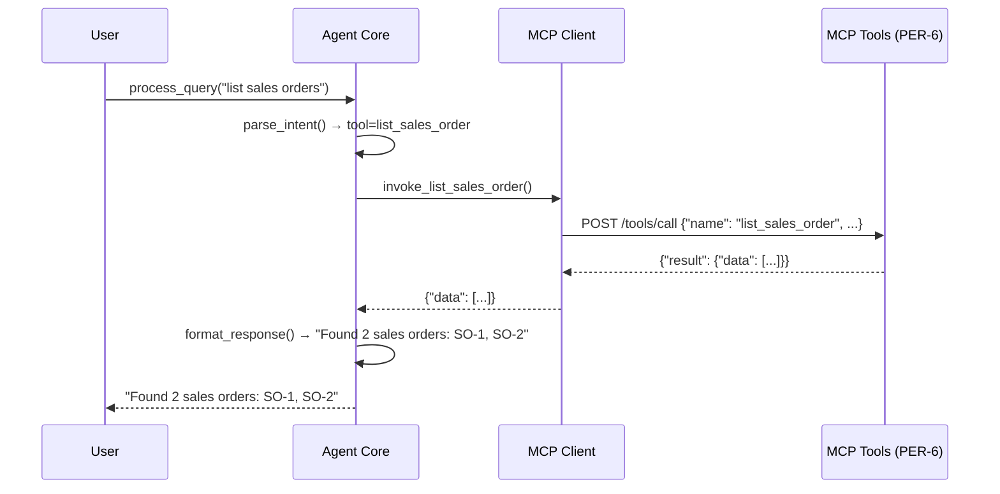

# High-Level Design: Agent Query MCP Tools for Sales Orders and Employees

**Document Version:** 4.0  
**Last Updated:** 2025-01-20  
**Status:** Draft

---

## Overview

This HLD describes an agent that answers user queries about sales orders and employees by invoking four MCP (Model Context Protocol) tools provided by PER-6. The agent translates natural language queries into appropriate tool calls and formats the responses for users. This is delivered as a **single story** (`01-agent`) implementing all three acceptance criteria in one cohesive implementation slice.

---

## Goals

- Enable natural language queries about sales orders and employees
- Integrate with existing MCP tools (`list_sales_order`, `list_employees`, `get_sales_order_by_id`, `get_employee_by_id`)
- Provide useful, formatted answers to users
- Support verification through automated tests

---

## Components

### Agent Core
**Purpose:** Orchestrates query processing and tool invocation.

**Responsibilities:**
- Parse user query intent (sales order vs employee, list vs get-by-id)
- Route to appropriate MCP tool via MCP Client
- Format tool responses into user-friendly answers
- Handle errors and edge cases (tool unavailable, invalid IDs, empty results)

**Key Behaviors:**
- Input: Natural language query string
- Output: Formatted response string or error message
- Query classification: keyword/pattern matching to determine tool + parameters
- Response formatting: structured data → readable text (output format `"Found 3 sales orders: SO-1, SO-2, SO-3"` or `"Employee John Doe (ID: E-42): Department: Engineering"`)

**Implementation:** Part of the single story `01-agent`, delivered in `agent/src/agent_core.py`

### MCP Tool Client
**Purpose:** Interface to MCP tools from PER-6.

**Responsibilities:**
- Invoke MCP tools with correct parameters via JSON-RPC over HTTP
- Handle tool responses and errors
- Return structured data to Agent Core

**Key Behaviors:**
- Input: Tool name + parameters
- Output: Tool response (structured data) or `None` on error
- No parsing/formatting logic (pure passthrough layer)
- Connection via `MCP_SERVER_URL` environment variable

**Implementation:** Part of the single story `01-agent`, delivered in `agent/src/mcp_client.py`

---

## Contracts

### Agent Core → MCP Client
```python
invoke_tool(tool_name, params) → response_data | None
```
- `tool_name`: one of the four MCP tool names
- `params`: tool-specific parameters (empty dict for list tools, `{"id": str}` for get-by-id tools)
- Returns: structured data from tool (dict with `data` key) or `None` on error

**Concrete Methods:**
- `invoke_list_sales_order() → dict | None`
- `invoke_list_employees() → dict | None`
- `invoke_get_sales_order_by_id(order_id: str) → dict | None`
- `invoke_get_employee_by_id(employee_id: str) → dict | None`

### User → Agent Core
```python
process_query(query: str) → answer: str
```
- `query`: natural language string (e.g., `"list all sales orders"`, `"get employee E-42"`)
- Returns: human-readable answer or error message

### MCP Client → MCP Tools (PER-6)
*Defined by PER-6; agent consumes as-is*

**Request Format (JSON-RPC 2.0):**
```json
{
  "jsonrpc": "2.0",
  "method": "tools/call",
  "params": {
    "name": "<tool_name>",
    "arguments": {}  // or {"id": "<value>"}
  },
  "id": <request_id>
}
```

**Response Format (Success):**
```json
{
  "jsonrpc": "2.0",
  "result": {
    "data": [...]  // or {...}
  },
  "id": <request_id>
}
```

**Response Format (Error):**
```json
{
  "jsonrpc": "2.0",
  "error": {
    "code": <error_code>,
    "message": "<error_message>"
  },
  "id": <request_id>
}
```

---

## Component Interactions



---

## Architecture Decisions

### AD-1: Query Intent Parsing Strategy
**Binds:** Agent Core uses keyword/regex matching (not LLM) to classify queries  
**Prevents:** Divergence in complexity/dependencies (no model inference needed)  
**Rule:** Match keywords → tool mapping:
- Keywords `"list"` + `"sales"` → `list_sales_order`
- Keywords `"list"` + `"employee"` → `list_employees`
- Keywords `"get"` + `"sales"` + ID pattern → `get_sales_order_by_id`
- Keywords `"get"` + `"employee"` + ID pattern → `get_employee_by_id`

ID extraction via regex: `\b([a-z0-9\-]+)\s*$`  
**Status:** [ADOPTED] — simple, deterministic, sufficient for AC2

### AD-2: MCP Client as Thin Wrapper
**Binds:** MCP Client does no business logic (no formatting, no caching, no retries)  
**Prevents:** Tight coupling between agent logic and tool interface  
**Rule:** One method per tool; pass params, return raw response or `None`  
**Status:** [ADOPTED] — decouples agent from tool changes; errors surface as `None`

### AD-3: Response Format
**Binds:** Responses are plain text strings, not structured data  
**Prevents:** User-facing output inconsistency  
**Rule:** 
- List queries → output format `"Found N items: [summary]"` (show first 5 IDs/names, then count remainder)
- Get-by-id → output format `"<Entity> <name> (ID: <id>): [key details]"` (e.g., amount for sales orders, department for employees)
- Errors → output format `"Error: <message>"`

**Status:** [ADOPTED] — AC2 requires "useful answers" (implies human-readable)

### AD-4: Connection Configuration
**Binds:** MCP Client connects via `MCP_SERVER_URL` environment variable (or constructor parameter override)  
**Prevents:** Hardcoded endpoints or config file sprawl  
**Rule:** `MCPClient(server_url=None)` reads `os.environ.get("MCP_SERVER_URL")` if `server_url` is `None`; raises `ValueError` if missing  
**Status:** [ADOPTED] — standard pattern for service endpoints

### AD-5: Error Handling Strategy
**Binds:** All errors return falsy values (`None`, error message strings), never raise exceptions after initialization  
**Prevents:** Caller complexity (no try/catch in business logic)  
**Rule:** 
- MCP Client: network/HTTP/parse errors → log warning, return `None`
- Agent Core: tool returns `None` → return error message string
- Only initialization raises exception (missing `MCP_SERVER_URL`)

**Status:** [ADOPTED] — simplifies Agent Core logic; all runtime errors handled gracefully

---

## Data Flow

1. **User Query** → Agent Core receives string
2. **Intent Parsing** → Agent Core classifies tool + extracts params (e.g., ID via regex)
3. **Tool Invocation** → Agent Core calls MCP Client method
4. **HTTP Request** → MCP Client sends JSON-RPC POST to MCP server
5. **Response Parsing** → MCP Client validates response structure, returns `result.data` or `None`
6. **Formatting** → Agent Core converts data dict to readable text per AD-3
7. **User Response** → Agent Core returns formatted string

---

## Error Handling

| Error Condition | MCP Client Behavior | Agent Core Behavior |
|-----------------|---------------------|---------------------|
| Unknown query intent | N/A | Return `"Error: Unable to understand query. Try 'list sales orders', 'list employees', 'get sales order <id>', or 'get employee <id>'"` |
| Missing ID in get-by-id query | N/A | Return `"Error: No <entity> ID provided. Use 'get <entity> <id>'"` |
| Network error (connection refused, timeout) | Log warning, return `None` | Return `"Error: Unable to fetch <entities>"` |
| HTTP error (4xx, 5xx) | Log warning with status code, return `None` | Return `"Error: Unable to fetch <entities>"` |
| Malformed response (missing `result` key) | Log warning, return `None` | Return `"Error: Unable to fetch <entities>"` |
| Tool error (e.g., ID not found) | Log warning with error details, return `None` | Return `"Error: <Entity> <id> not found"` |
| Empty list response | Return `{"data": []}` | Return `"No <entities> found"` |
| Missing `MCP_SERVER_URL` | Raise `ValueError` in `__init__` | N/A (initialization fails before Agent Core creation) |

---

## File Structure

```
agent/
├── src/
│   ├── mcp_client.py         # NEW: MCP tool invocation wrapper
│   └── agent_core.py         # NEW: Agent orchestration + query processing
└── tests/
    ├── test_mcp_client.py    # NEW: unit tests for MCP client (4 tests)
    └── test_agent.py         # NEW: integration tests for agent (4 tests)
```

All files are new; no existing repo files modified. All files are delivered as part of the single story `01-agent`.

---

## Risks

| Risk | Likelihood | Impact | Mitigation |
|------|------------|--------|------------|
| MCP tool signatures change (PER-6) | Medium | High | MCP Client isolates changes; update one method per tool |
| Query parsing fails on unexpected input | Medium | Medium | Document supported query patterns in error message; return helpful error |
| MCP server unavailable at runtime | Medium | High | MCP Client logs errors and returns `None`; Agent Core returns error message to user |
| Tool response format varies | Low | Medium | MCP Client validates response structure (checks for `result.data`); logs warnings on malformed responses |

---

## Dependencies

- **PER-6 (MCP Server Tools):** Must be complete and accessible at `MCP_SERVER_URL` before agent can invoke tools
- **PER-5 (GraphQL Schemas):** Indirect dependency (tools use these, agent does not)
- **Python `requests` library:** HTTP client for JSON-RPC calls
- **Python `pytest` library:** Test framework

---

## Acceptance Criteria Coverage

### AC1: Agent code exists
- **Verification:** Agent source files exist in repository
  - `agent/src/mcp_client.py` (MCP Client class with four tool methods)
  - `agent/src/agent_core.py` (Agent Core class with `process_query` method)
  - `agent/tests/test_mcp_client.py` (unit tests)
  - `agent/tests/test_agent.py` (integration tests)
- **Test Coverage:** 4 unit tests in `test_mcp_client.py` verify MCP client provides methods for all four tools (success paths)

### AC2: Agent can invoke all four MCP tools and return useful answers
- **Verification:** Execute queries covering all four tools; inspect responses
- **Test Coverage:** 4 integration tests in `test_agent.py` verify AC2
  - `test_verify_list_sales_order`: query `"list sales orders"` → response format `"Found N sales orders: ..."`
  - `test_verify_list_employees`: query `"list employees"` → response format `"Found N employees: ..."`
  - `test_verify_get_sales_order_by_id`: query `"get sales order SO-1"` → response format `"Sales Order SO-1: Amount: ..."`
  - `test_verify_get_employee_by_id`: query `"get employee E-1"` → response format `"Employee <name> (ID: E-1): Department: ..."`
- **Outcome:** Each query produces non-error, readable response per AD-3

### AC3: Basic tests or documented manual verification script
- **Verification:** Run automated test suite
- **Test Coverage:** 8 tests total (4 unit tests + 4 integration tests) satisfy "basic tests" requirement
- **Outcome:** All tests pass

### Total Test Count
**8 tests** (aligned with ticket, requirements, breakdown, and story LLD):
- **4 MCP client unit tests** (one per tool, success paths) — verify AC1 (code exists and provides tool methods)
- **4 agent integration tests** (one per tool, verifying end-to-end flow) — verify AC2 (all four tools invocable and responses formatted correctly)
- Together, all 8 tests verify AC3 (basic tests requirement)

---

## Open Questions

1. ~~**MCP tool connection details:** How does the agent connect to MCP tools?~~  
   **Resolved:** Environment variable `MCP_SERVER_URL` (see AD-4)

2. ~~**Query pattern examples:** What exact query strings should be supported?~~  
   **Resolved:** Minimal set: `"list sales orders"`, `"list employees"`, `"get sales order <id>"`, `"get employee <id>"` (see AD-1)

3. ~~**Response detail level:** Should list queries return full details or just IDs/names?~~  
   **Resolved:** Summary (count + first 5 IDs/names) for lists, full key details for get-by-id (see AD-3)

---

## Notes

- Authentication is out of scope (assumed handled by MCP tools or infrastructure)
- Agent does not implement GraphQL or MCP tools (dependencies from PER-5/PER-6)
- Response formatting prioritizes readability over structured data (AD-3)
- **Single-story implementation:** All three ACs delivered in one story (`01-agent`)
- Test count is **8** (4 MCP client unit tests + 4 agent integration tests), aligned across all artifacts
- All file paths are under `agent/` subtree (matching repo-tree context); stack is Python (matching project-context)
- No invented acceptance criteria beyond ticket AC1, AC2, AC3
- Error handling follows fail-safe pattern: log and return falsy values, never crash (AD-5)

---

**End of HLD**
